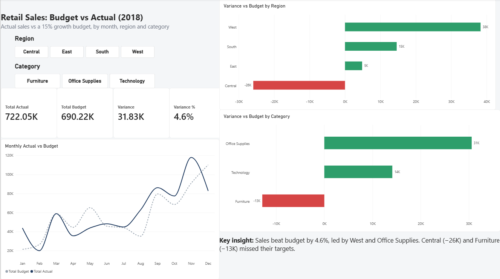
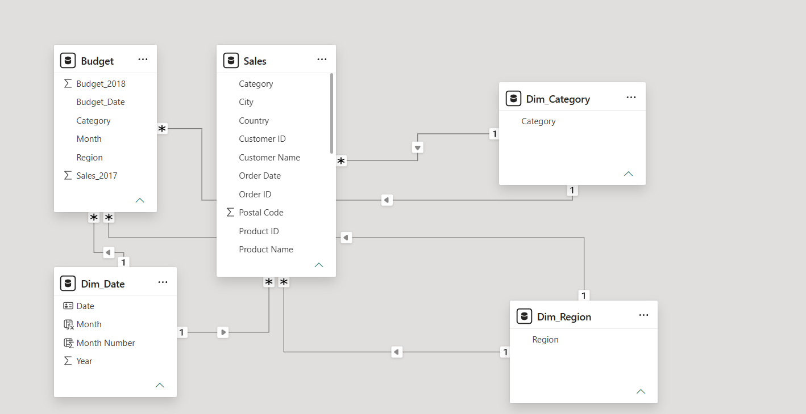

# 📊 Retail Budget vs Actual Dashboard (Power BI)

> Did the business hit its 2018 sales target, and where did it beat or miss?



## Overview

This project is an end-to-end budget-vs-actual analysis built on US retail sales data. The source data holds actuals only, so I built a **2018 budget** from 2017 sales. I then modelled both in Power BI to show where the business beat or missed target by **month, region and category**.

**Headline result:** 2018 actual sales were **$722K against a $690K budget (+$31.8K, +4.6%)**.

## Dataset

- **Source:** [Superstore Sales Dataset](https://www.kaggle.com/datasets/rohitsahoo/sales-forecasting) (Kaggle)
- **Size:** ~9,800 order lines, US retail, 2015–2018
- **Note:** the dataset contains **actual sales only**. The **budget was built by me** (see [Budget Assumption](#budget-assumption)).

## Tools

| Tool | Used for |
| --- | --- |
| **Excel** | Power Query (cleaning), PivotTables (exploration), budget calculation |
| **Power BI** | Power Query, star-schema data model, DAX measures, report design |
| **Git / GitHub** | Version control |

## Process

1. **Data cleaning:** dates were `dd/mm/yyyy` but read as `mm/dd/yyyy`, silently corrupting about half of them. Fixed with locale-aware type conversion in Power Query.
2. **Exploration:** year-over-year sales growth was 2016 −4.3%, 2017 +30.6%, 2018 +20.3%.
3. **Budget creation:** 2018 budget = 2017 actual sales × (1 + 15%), built at **Month × Region × Category** level (144 rows) so the budget follows seasonality.
4. **Data model:** star schema with shared dimension tables (Date, Region, Category) connected to both the Sales and Budget fact tables.
5. **DAX measures:** Total Actual, Total Budget, Variance, Variance %.
6. **Dashboard:** KPI cards, monthly trend, variance by region and category, slicers.

## Budget Assumption

The 2018 budget assumes **15% growth over 2017 actuals**. Sales grew 30.6% in 2017, but 2016 declined 4.3%, so recent growth had been volatile. A 15% target sits between those extremes. It is ambitious but achievable, and it avoids baking an exceptional year's growth into the plan. Applying the uplift to each Month × Region × Category combination keeps the seasonal pattern in the target.

## Data Model



Sales (order level) and Budget (month level) have different granularity, so they can't be joined directly. Both connect to shared dimension tables, so a single slicer filters actuals and budget together.

## Key Insights

- **Beat budget overall:** $722K actual vs $690K budget, **+$31.8K (+4.6%)**.
- **Best performers:** the **West** region (+$38.3K, +18.2%) and the **Office Supplies** category (+$30.6K, +14.6%). The **South** also beat budget by 13.6%.
- **Missed:** the **Central** region was 15.5% below budget (−$25.9K), and **Furniture** was 5.7% below (−$12.9K).
- **Seasonality gaps:** the biggest shortfalls were **May (−32.7%)**, **Dec (−24.6%)** and **Feb (−24.6%)**, with Apr also below (−20.1%). Strong **Nov (+29.7%)**, **Aug** and **Jan** offset them. The monthly swings show the budget's seasonal shape didn't match 2018 demand.

## Challenges & What I Learned

- **Date-locale bug:** a `dd/mm/yyyy` vs `mm/dd/yyyy` mismatch silently corrupted about half the dates. I now check date parsing before any time-based analysis.
- **Circular dependency error:** it appeared when sorting months in Power BI. I resolved it by sorting the month name by a month-number column in the date table.
- **Hidden trailing space:** a column named `"Month "` broke relationships and lookups. I now inspect column names when data won't match.

## Repository Structure

```text
retail-budget-vs-actual-dashboard/
├── data/
│   ├── raw/train.csv              # original dataset
│   └── processed/budget_2018.csv  # budget built from 2017 actuals
├── analysis/exploration.xlsx      # pivots, YoY growth, budget logic
├── powerbi/retail_budget_vs_actual.pbix
└── images/                        # screenshots
```

## How to Open

1. Download or clone this repo and open `powerbi/retail_budget_vs_actual.pbix` in Power BI Desktop.
2. If data doesn't load: **Transform data → Data source settings → Change Source**, and point to the CSV files in the `data/` folder.
